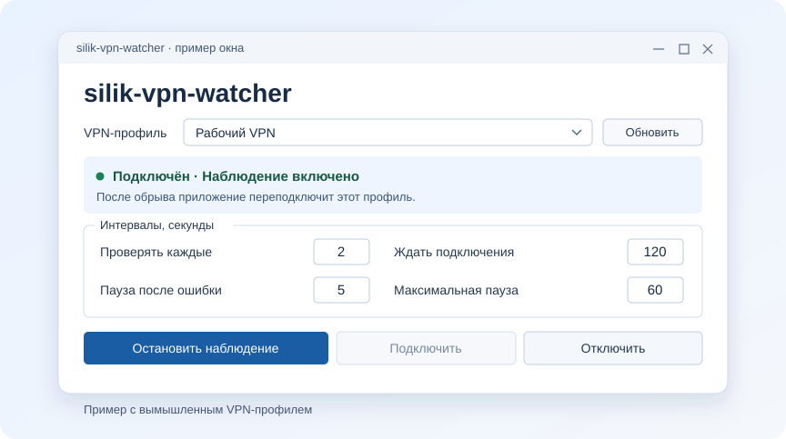

# Наблюдатель VPN для Windows

**Небольшое приложение, которое восстанавливает выбранный VPN Windows после обрыва.** Выберите профиль, включите наблюдение и продолжайте работу. Если туннель исчезнет, приложение запустит подключение и дождётся результата Windows.

**[Скачать VpnWatch.exe](https://github.com/silikonoff/vpn-watch/releases/latest/download/VpnWatch.exe)** · [Релизы и SHA-256](https://github.com/silikonoff/vpn-watch/releases)

Windows 10/11 x64 · .NET Framework 4.8 · Один файл · Русский интерфейс



## Как пользоваться

1. Запустите `VpnWatch.exe` обычным пользователем Windows. Установка не нужна.
2. Выберите VPN, который уже настроен в Windows. Если данные для входа ещё не сохранены, нажмите **Подключить** и сохраните их в штатном диалоге Windows.
3. Нажмите **Включить наблюдение**. Если туннель отключён, приложение сразу попробует подключить его. После обрыва повторная попытка начнётся при ближайшей проверке.
4. Когда VPN больше не нужен, нажмите **Остановить наблюдение**, затем **Отключить**. Кнопка **Отключить** также выключает наблюдение.

Наблюдение работает, пока открыто окно приложения. При закрытии наблюдатель прекращает повторы. Уже поднятый туннель остаётся подключённым.

## Интервалы

| Настройка | По умолчанию | Что регулирует |
| --- | ---: | --- |
| Проверять каждые | 2 с | Как часто приложение читает состояние VPN. |
| Ждать подключения | 120 с | Сколько ждать завершения одной фоновой попытки. |
| Пауза после ошибки | 5 с | Задержка перед первым повтором. |
| Максимальная пауза | 60 с | Предел задержки, которая растёт после последовательных ошибок. |

Одновременно выполняется одна попытка. После успешного подключения задержка сбрасывается. Интервалы сохраняются при закрытии окна в `%LOCALAPPDATA%\VpnWatch\timers.txt`. При следующем запуске наблюдение выключено.

## Совместимость

Приложение работает со штатными VPN-профилями Windows. Фоновый вход рассчитан на профиль с сохранённым паролем в Windows. Проверено подключение SSTP с MS-CHAP v2. Для других протоколов и способов входа, например с интерактивным MFA, автоматическое переподключение требует отдельной проверки.

Данные для входа использует Windows. Приложение не сохраняет свою копию пароля, не меняет настройки VPN-профилей и сохраняет проверку сертификата. При ошибке входа или недоверенном сертификате наблюдение приостанавливается до вмешательства пользователя.

Если нужного профиля нет в списке, откройте **Параметры → Сеть и Интернет → VPN**, добавьте профиль и нажмите **Обновить** в приложении. Если автоматическое подключение остановилось, сначала проверьте ручной вход через Windows.

## Сборка из исходников

В корне репозитория запустите PowerShell:

```powershell
.\Build.ps1 -Verify
```

Сборка использует компилятор .NET Framework из Windows. Готовый файл появится в `dist\VpnWatch.exe`. Ключ `-Verify` проверяет таймеры, повторные попытки и остановку наблюдения. Дополнительный ключ `-Probe` читает список и состояние локальных VPN-профилей без подключения к ним.

Проверить контрольную сумму загруженного файла можно через `Get-FileHash .\VpnWatch.exe -Algorithm SHA256`. Сравните результат с `SHA256SUMS.txt` из того же релиза.
